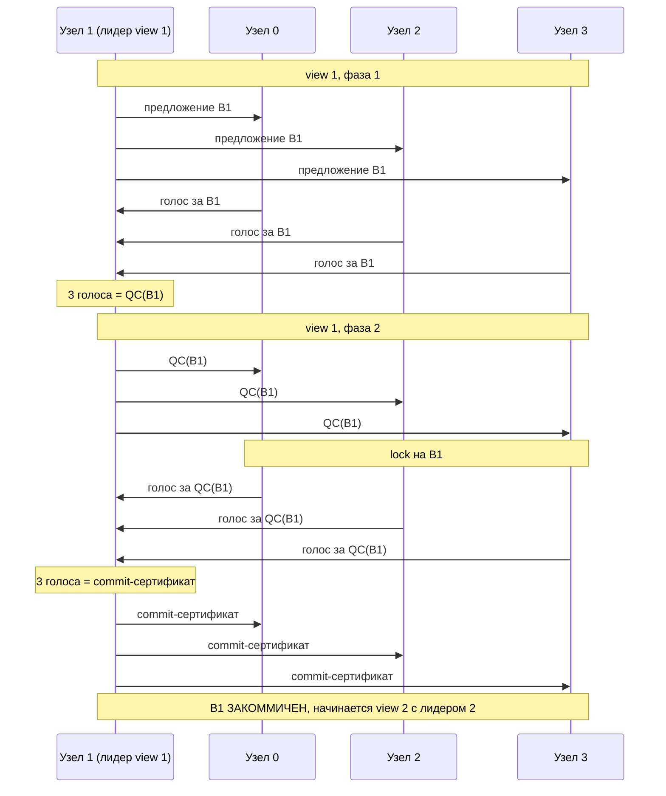
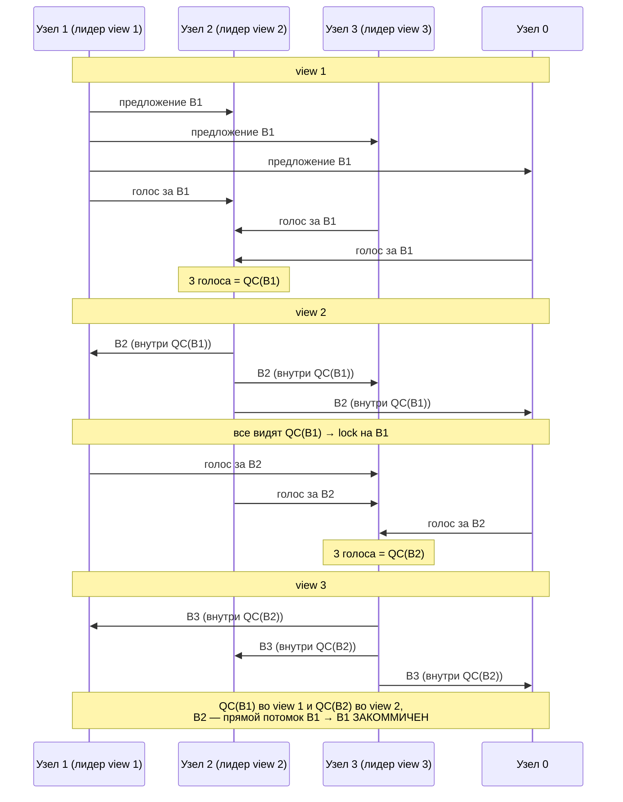

# HotStuff-2: обзор для новичка

Этот документ — вводный. Он объясняет простыми словами, что делает протокол и как устроен проект.
Точная спецификация лежит в [`spec/protocol.md`](spec/protocol.md), модель на Quint — в [`spec/quint`](spec/quint).

---

## 1. Какую проблему решаем

Представь, что у нас есть несколько серверов (узлов), и все они должны вести **одну и ту же историю** —
например, список транзакций в блокчейне или журнал операций базы данных.
Каждый узел хранит свою копию, и копии должны совпадать.

Сложности:

- **Сеть ненадёжна.** Сообщения задерживаются, приходят в разном порядке, иногда теряются.
- **Узлы могут падать.** Сервер выключился посреди работы.
- **Узлы могут врать.** Самое неприятное: часть узлов может быть взломана или сознательно
  вести себя злонамеренно — рассылать разным узлам разные данные, голосовать за два варианта сразу,
  молчать в нужный момент. Такие узлы называют **византийскими** (от «задачи византийских генералов»).

Протокол **консенсуса** — это набор правил, по которым честные узлы договариваются о
**едином порядке блоков**, несмотря на всё это. Он гарантирует два свойства:

| свойство | что значит простыми словами |
|---|---|
| **Safety** (безопасность) | Два честных узла никогда не примут разные блоки на одно и то же место в истории. Ни при каких задержках и ни при каком поведении злоумышленников. |
| **Liveness** (живучесть) | Если сеть рано или поздно начинает работать нормально, история продолжает расти — новые блоки принимаются. |

### Сколько врунов можно пережить

Узлов `n`, из них могут врать не больше `f`, где **`n = 3f + 1`**.
Например, из **4** узлов может врать **1**, из **7** — **2**.

Ключевое число — **кворум**: `2f + 1` узлов (3 из 4, 5 из 7).
Любые два кворума пересекаются хотя бы в одном **честном** узле —
на этом держится вся безопасность: нельзя набрать кворум «за» два противоречащих варианта,
потому что честный узел из пересечения не проголосует дважды.

---

## 2. Основные понятия

| понятие | что это |
|---|---|
| **Блок** | Порция данных (транзакций). Каждый блок ссылается на **родителя** — так блоки выстраиваются в цепочку. |
| **View** | «Раунд» протокола. Номер view только растёт: 1, 2, 3, … В каждом view есть ровно один **лидер**. |
| **Лидер** | Узел, который в своём view предлагает новый блок. Лидеры меняются по кругу: `лидер(v) = v mod n`. |
| **Голос** | Подпись узла «я согласен с этим блоком в этом view». |
| **QC** (Quorum Certificate) | Пачка голосов от кворума (`2f+1`) за один блок. Это доказательство «большинство честных видело и одобрило этот блок». |
| **Lock** (замок) | Каждый узел помнит самый свежий QC, на который он «залочился». Он не будет голосовать за блок, который строится на более старом QC. Это защищает уже почти принятые блоки. |
| **Commit** | Блок окончательно принят и больше никогда не изменится. Его можно исполнять. |
| **Timeout / TC** | Если лидер молчит или сломан, узлы по таймеру договариваются перейти в следующий view. Доказательство такого договора — **TC** (Timeout Certificate). |

---

## 3. Из чего состоит узел

Каждый узел — это несколько независимых компонентов, которые общаются через события.

```
                    ┌───────────────────────────────┐
     сообщения      │            Driver             │      сообщения
  ─────────────────▶│  (маршрутизатор событий)      │─────────────────▶
     из сети        │                               │      в сеть
                    └──┬──────────┬──────────┬──────┘
                       │          │          │
              ┌────────▼───┐ ┌────▼──────┐ ┌─▼──────────┐
              │ Consensus  │ │ Pacemaker │ │ Collector  │
              │ голоса,    │ │ views,    │ │ голоса→QC  │
              │ lock,      │ │ лидеры,   │ │ wish→TC    │
              │ commit     │ │ таймеры   │ │            │
              └─────┬──────┘ └───────────┘ └────────────┘
                    │
              ┌─────▼──────┐        ┌────────────┐
              │  Storage   │◀──────▶│ Blocksync  │
              │  блоки,    │        │ догрузка   │
              │  коммиты   │        │ блоков     │
              └────────────┘        └────────────┘
```

### Consensus — «голосовать и принимать»

Отвечает за **безопасность**:

- получает предложение блока от лидера и решает, можно ли за него голосовать
  (блок продолжает свой QC, не противоречит lock'у, узел ещё не голосовал в этом view);
- обновляет **lock**, когда видит новый QC;
- решает, когда блок **закоммичен** (правило ниже, в разделе 4);
- строит новый блок, когда узел сам стал лидером.

Consensus ничего не знает про время и таймеры. Он только проверяет правила.

### Pacemaker — «кто сейчас главный и когда двигаться дальше»

Отвечает за **живучесть**:

- знает текущий view и его лидера;
- двигает узел в следующий view — по QC (всё хорошо) или по таймауту (лидер подвёл);
- держит таймеры: **view-таймер** (сколько ждать в этом view) и **lock-таймер**
  (сколько лидер ждёт статусов, прежде чем предложить блок после сбоя);
- синхронизирует узлы после сбоев: рассылает **wish** («хочу в следующий view»),
  собирает из них **TC** и раздаёт его всем.

Pacemaker не трогает блоки — он только говорит, когда и кому предлагать.

### Collector — «собрать подписи в сертификат»

Копит входящие голоса по view. Как только от разных узлов набралось `2f+1` голосов за
один блок — выдаёт **QC**. Точно так же из `2f+1` wish собирает **TC**.

### Driver — «клей»

Получает события (сообщение из сети, сработал таймер), вызывает нужные компоненты в правильном
порядке и отправляет результаты: сообщения в сеть, команды таймерам.
Сами компоненты не общаются друг с другом напрямую — только через driver.
Это делает каждый из них простой функцией «состояние + событие → новое состояние + действия»,
которую легко тестировать и проверять формально.

### Storage — «где лежат блоки»

Хранит все полученные блоки и цепочку закоммиченных. Consensus читает из него родителей блоков,
чтобы проверять цепочку.

### Blocksync — «догнать остальных»

Если узел отстал (был выключен, потерял сообщения), у него нет части блоков.
Blocksync запрашивает недостающие блоки у других узлов. **Пока не реализован** —
в коде заготовка `consensus/src/blocksync`.

---

## 4. Happy path: как всё работает, когда всё хорошо

Возьмём 4 узла (`n = 4`, `f = 1`, кворум = 3). Лидеры по кругу: view 1 → узел 1, view 2 → узел 2, view 3 → узел 3.

Сначала посмотрим на протокол **без конвейера** — так проще понять, зачем нужны две фазы голосования.
Потом — на конвейерную версию, которую мы реализуем: она делает то же самое, только быстрее.

### 4.1. Без конвейера: один лидер, две фазы на каждый блок

В базовой версии HotStuff-2 лидер сам проводит свой блок через **две фазы голосования**:

1. **Фаза 1 (lock).** Лидер рассылает блок B, узлы голосуют, лидер собирает **QC(B)** и рассылает его.
   Получив QC(B), каждый узел **лочится** на B: «за что-то, что не продолжает B, я больше не голосую».
2. **Фаза 2 (commit).** Узлы голосуют ещё раз — уже за QC(B). Лидер собирает второй сертификат и рассылает его.
   Получив его, узлы **коммитят** B.

Только после этого начинается следующий view со следующим лидером и следующим блоком.



Зачем две фазы, а не одна? Если бы узлы коммитили сразу по QC(B1), то при сбое лидера
часть узлов успела бы закоммитить B1, а часть — нет, и следующий лидер мог бы
«не заметить» B1 и построить другую историю. Первая фаза гарантирует, что кворум **залочен** на B1,
и следующий лидер обязан его продолжить; только после этого B1 можно коммитить.

Минус: на каждый блок уходит **два круга голосования**, и всё это время следующий блок ждёт.

### 4.2. С конвейером: фазы соседних блоков совмещаются

Заметим, что фаза 2 блока B1 и фаза 1 блока B2 — это одинаковые по форме сообщения:
лидер рассылает что-то, узлы голосуют. Их можно **совместить**: вместо отдельного
«голосуем за QC(B1)» следующий лидер кладёт QC(B1) прямо в свой новый блок B2.
Голос за B2 одновременно значит «одобряю B2» (фаза 1 для B2) и «видел QC(B1)» (фаза 2 для B1).

```
 без конвейера:   [B1: фаза 1][B1: фаза 2][B2: фаза 1][B2: фаза 2][B3: фаза 1]...
                  └─────── B1 ───────────┘└─────── B2 ───────────┘

 с конвейером:    [B1: фаза 1][B2: фаза 1][B3: фаза 1][B4: фаза 1]...
                              [B1: фаза 2][B2: фаза 2][B3: фаза 2]...
                               └ одно и то же голосование ┘
```

Без конвейера новый блок появляется раз в **два** круга голосования, с конвейером — **каждый** круг.
Правила безопасности (lock, кворумы, коммит после двух сертификатов подряд) при этом те же самые —
конвейер это **оптимизация пропускной способности**, а не другой протокол.

Цена: теперь фазы одного блока ведут **два разных лидера** (фазу 1 — лидер view v, фазу 2 — лидер view v+1).
Если второй из них нечестный, он может выбросить голоса за чужой блок — это называется tail-forking,
см. `todo.md`. Безопасность от этого не страдает, страдает только скорость.

Главная хитрость конвейерного HotStuff — **голоса отправляются не текущему, а следующему лидеру**.
Он собирает из них QC и кладёт его в свой новый блок. Так одно сообщение
одновременно двигает протокол вперёд и доказывает, что предыдущий блок одобрен.
Это называется **конвейер** (pipelining): каждый view одновременно предлагает новый блок
и подтверждает предыдущий.



То же самое в виде цепочки блоков:

```
 view:      1            2            3            4
         ┌──────┐     ┌──────┐     ┌──────┐     ┌──────┐
 блок:   │  B1  │◀────│  B2  │◀────│  B3  │◀────│  B4  │ ...
         └──────┘     └──────┘     └──────┘     └──────┘
 внутри:              QC(B1)       QC(B2)       QC(B3)

 после B3:  B1 закоммичен
 после B4:  B2 закоммичен
 ...
```

### 4.3. Правило коммита (двухзвенная цепочка)

Блок **B закоммичен**, когда узел видит:

1. **QC(B)** — сертификат за B, собранный во view `v`;
2. **QC(B')** — сертификат за прямого потомка B, собранный в **следующем** view `v + 1`.

Почему этого достаточно: раз за B' проголосовал кворум, то больше `f` честных узлов
**залочились на QC(B)**. Они никогда не проголосуют за блок, который не продолжает B.
Значит, ни один будущий QC не сможет «обойти» B — его место в истории закреплено навсегда.

Поэтому в happy path каждый новый view коммитит один блок — тот, что был предложен
на два view раньше.

---

## 5. Когда что-то идёт не так

### Лидер молчит или византийский

1. У всех узлов истекает **view-таймер**.
2. На границе эпохи узлы рассылают **wish** «хочу в view v+1».
3. Из `2f+1` wish собирается **TC** — доказательство, что кворум хочет двигаться дальше.
4. TC рассылается всем, все переходят в view `v + 1` с новым лидером.

Как именно это устроено — в следующем разделе.

### View sync: как узлы держатся в одном view

**Проблема.** У каждого узла свои часы и свой `cur_view`. Сообщения задерживаются, кто-то
перезагрузился, кто-то пропустил QC. Если узлы окажутся в разных views, они будут ждать
разных лидеров и не смогут собрать кворум ни в одном view. Задача view sync — снова
собрать честных узлов в одном view, причём **дёшево**: без постоянной рассылки «я во view N» всем подряд.

**Быстрый путь — QC.** Пока всё хорошо, синхронизация бесплатная: QC за view `v` лежит
внутри предложения view `v + 1`, и любой узел, получив его, сразу переходит в `v + 1`.
Отдельные сообщения не нужны. View sync работает только тогда, когда QC нет.

**Медленный путь — таймеры, эпохи и TC.** Views сгруппированы в **эпохи** по `f + 1` подряд
(при `n = 4` это пары: {0, 1}, {2, 3}, {4, 5}, …). Внутри эпохи и на её границе узлы ведут себя по-разному:

```
            эпоха 1                       эпоха 2
   ┌────────────┬────────────┐ ┌────────────┬────────────┐
   │   view 2   │   view 3   │ │   view 4   │   view 5   │
   └────────────┴────────────┘ └────────────┴────────────┘
     таймер      таймер  ──▶ wish ──▶ TC ──▶ все вместе
     истёк →     истёк       лидерам   всем    входят в view 4,
     сам в 3     (граница)   эпохи 2           таймеры заново
     (молча)
```

1. **Внутри эпохи — молча.** Истёк таймер view 2 → узел сам переходит в view 3, никому ничего не сообщая.
   Внутри эпохи узлы могут чуть разойтись по времени, но не сильно: все стартовали эпоху вместе
   и отсчитывают одинаковые интервалы.
2. **На границе эпохи — договариваются.** Истёк таймер последнего view эпохи (view 3) →
   узел шлёт **wish «хочу в view 4»**, но не всем, а только **лидерам следующей эпохи**
   (лидерам views 4 и 5, их `f + 1`). Среди `f + 1` лидеров хотя бы один честный.
3. **Лидер собирает TC.** Набрав `2f + 1` wish, лидер получает **TC(4)** — доказательство,
   что кворум честно устал ждать и хочет дальше. Он рассылает TC **всем**.
4. **Ретрансляция.** Кто первым получил TC, пересылает его лидерам эпохи. Даже если
   византийский узел показал TC только одному честному, через одну пересылку его увидят все.
5. **Все входят в эпоху 2 одновременно** по TC и **заново запускают таймеры** для её views.
   Расхождение, накопившееся за прошлую эпоху, обнуляется.

**Почему эпохи, а не синхронизация каждого view.** Рассылка wish и TC стоит дорого:
на каждый view это порядка `n²` сообщений. Эпоха из `f + 1` views платит эту цену один раз,
а внутри неё узлы двигаются бесплатно, по таймерам. Размер `f + 1` выбран так, чтобы в эпохе
гарантированно был хотя бы один честный лидер: если все предыдущие подвели, он проведёт
свой view, и протокол сдвинется.

**Статусы (Case 2).** Когда узел вошёл во view не по QC (а по таймеру или TC), он посылает
лидеру этого view **статус** — свой самый свежий QC. Лидер ждёт статусы не дольше lock-таймера
и строит блок на самом свежем QC, который о нём узнал. Это следующий раздел.

### Новый лидер после сбоя (Case 2)

Новый лидер не знает, какой QC самый свежий у других — может, кто-то видел то, чего не видел он.
Поэтому он:

1. ждёт **статусы** от узлов (каждый присылает свой самый свежий QC) — не дольше lock-таймера;
2. берёт самый свежий QC и строит блок на нём.

Если же лидер вошёл во view, имея QC за прошлый view (Case 1), он предлагает блок **сразу** —
это и есть «оптимистичная отзывчивость»: при хорошей сети протокол работает со скоростью сети,
а не со скоростью таймеров.

### Почему безопасность не ломается

Что бы ни происходило с таймерами и лидерами, **lock** не даёт честным узлам проголосовать
против уже почти принятого блока, а **кворумы пересекаются** в честном узле.
Таймауты могут только **замедлить** протокол, но не заставить честных принять разные истории.

---

## 6. Где что лежит в проекте

| путь | что там |
|---|---|
| `docs/spec/protocol.md` | Точный псевдокод протокола: что делает каждый обработчик. |
| `docs/spec/invariants.md` | Свойства, которые должны выполняться всегда (их проверяет модель). |
| `docs/spec/quint/` | Формальная модель на [Quint](https://quint-lang.org): consensus, pacemaker, collector, driver, сеть и византийские узлы. Её можно «прогонять» и искать нарушения автоматически — см. `README.md` там же. |
| `consensus/src/` | Реализация на Rust: `consensus`, `pacemaker`, `blocksync`, `network`, `storage`, `types`. |
| `crypto/` | Подписи и пороговые подписи (из них собираются QC и TC). |

### С чего начать

1. Прочитать этот файл и раздел 4 ещё раз — happy path важнее всего.
2. Открыть `docs/spec/protocol.md` и найти там обработчики из раздела 3:
   `upon NewProposal`, `update`, `upon NewVote`, `advanceView`, `upon ViewTimerFired`.
3. Прогнать модель по инструкции из `docs/spec/quint/README.md` и посмотреть на
   сводку трассы: там видно, как появляются QC и коммиты, — тот же happy path, только «вживую».

---

## Словарь

| термин | расшифровка |
|---|---|
| BFT | Byzantine Fault Tolerance — устойчивость к византийским (лгущим) узлам |
| `n`, `f` | число узлов и максимум византийских, `n = 3f + 1` |
| кворум | `2f + 1` узлов |
| view | раунд протокола с одним лидером |
| эпоха | группа из `f + 1` подряд идущих views, на границе которой узлы синхронизируются через wish/TC |
| QC | Quorum Certificate — `2f+1` голосов за блок |
| TC | Timeout Certificate — `2f+1` wish за переход в следующий view |
| lock | QC, на который узел залочился; ниже него голосовать нельзя |
| commit | окончательное принятие блока |
| GST | Global Stabilization Time — момент, после которого сеть «нормальная» и сообщения доходят вовремя |
